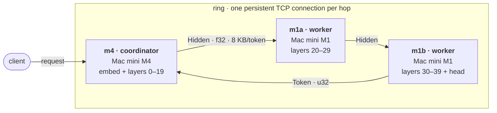
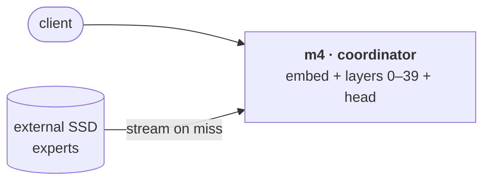

# moe-service-handler

Turns moeflux into a service that runs Qwen3.6-35B-A3B on one Mac mini
(mode A) or a three-node pipeline of Mac minis (mode B). moeflux owns everything inside one
machine (memory cap, expert streaming, kernels); this repo owns everything that spans
machines or requests. Full requirements: [`moe-service-handler-prd.md`](moe-service-handler-prd.md).

## Architecture

### Mode B — three-node pipeline

Each node runs a contiguous layer range. Nodes form a ring: hidden states flow forward,
the last node samples a token and sends it back to the coordinator.



- **Frames:** 24-byte little-endian header (magic, version, type, request id, position,
  length) + payload. Types: `Hidden`, `Token`, `Drop`, `Ping`/`Pong`, `Hello`, `Error`.
- **f32 on the wire:** the engine works in f32, so a split pipeline stays bit-identical to
  one process.
- **`Drop`** travels the whole ring; when it returns, every node has freed the request.
- **Errors** on a worker reach the coordinator as an `Error` frame; the ring stays up.

### Mode A — single node

Same binary and config format, one node with `layers = [0, 40]`; no network.



## Crates

| Crate | Kind | Purpose | State |
| --- | --- | --- | --- |
| `msh-net` | library + `msh-probe` | Frames, connections, latency probe | M0 done |
| `msh-node` | binary | Coordinator / worker, config, ring | M1 pipeline done on a mock engine |
| `msh-policy` | library | Per-expert 4-bit / 2-bit / skip rules | Not started |

The engine sits behind an `Engine` trait. `MockEngine` stands in until moeflux ships
layer-range execution (moeflux Phase 3).

## Quick start

```bash
cargo test --release

# three nodes on one machine over loopback
B=target/release/msh-node
$B --config configs/local-3node.toml --node m1b &
$B --config configs/local-3node.toml --node m1a &
$B --config configs/local-3node.toml --node m4 --max-tokens 64

# network round-trip probe: serve on one machine, run from another
target/release/msh-probe serve 0.0.0.0:7070
target/release/msh-probe run <host>:7070 ethernet results/m0-<name>.csv
```

## Baseline numbers

Loopback on a MacBook Pro M3 Pro ([`results/m0-m3pro-local.csv`](results/m0-m3pro-local.csv)),
the software floor for the M4↔M1 runs:

| Payload | Round trip p50 | One hop |
| --- | --- | --- |
| 4 KB | 13.7 µs | ~7 µs |
| 1 MB | 137 µs | ~68 µs |
| 16 MB | 3.2 ms | ~1.6 ms |

## License

MIT — see [`LICENSE`](LICENSE).
